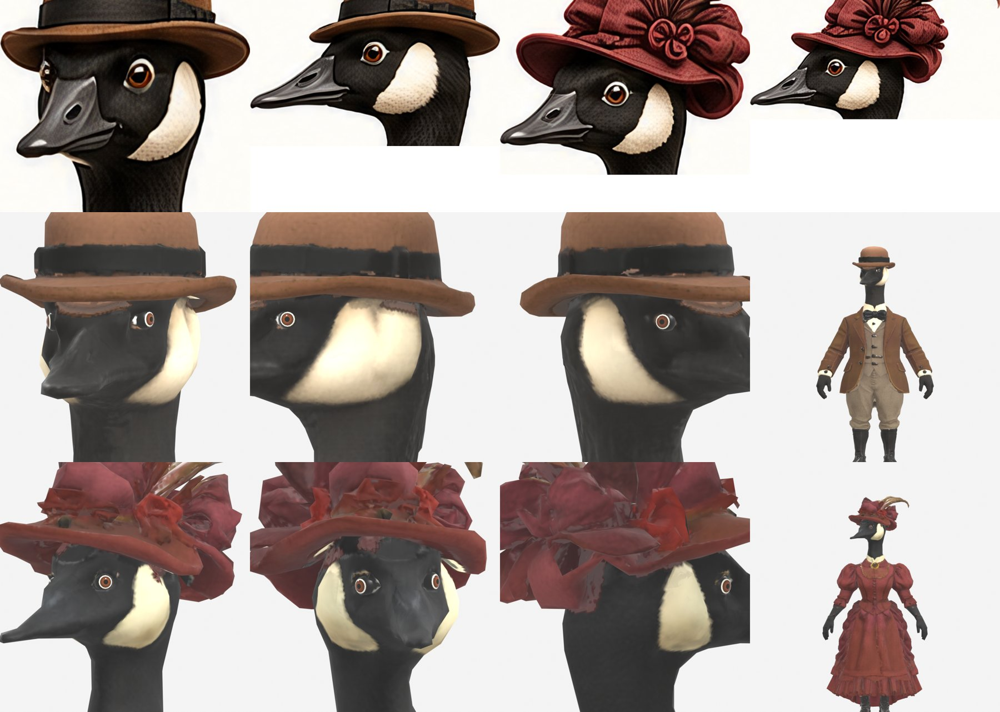

# Tandemonium geese — 3D characters

Game-ready 3D models of the two Victorian Canada geese who ride the tandem in
[Tandemonium](https://github.com/petegordon), built from a hand-drawn turnaround sheet with
local image-to-3D generation (TRELLIS.2-based Pixal3D multi-view in ComfyUI) and a scripted
Blender 5.2 cleanup / retopology / bake pipeline.



| | Male | Female |
|---|---|---|
| Game mesh | 19,558 tris, 1 draw call | 19,558 tris, 1 draw call |
| glTF validator | 0 errors / 0 warnings | 0 errors / 0 warnings |
| Silhouette IoU vs sheet | 0.938 | 0.913 |

GLBs are attached to the [Releases](../../releases).

- **[ROADMAP.md](ROADMAP.md)** — plan of record: foundation fixes → shared rig → riding the tandem → wardrobe (clothing changes) → game delivery. Tracked as GitHub milestones and issues.
- **[PLAN.md](PLAN.md)** — pipeline manual, decisions and progress log.

## Pipeline

```
refs/characters-turnaround.png
  └─ scripts/comfy_job.py prep / pixal-mv      (ComfyUI :8189, multi-view → textured GLB, seed sweep)
  └─ scripts/review_candidate.py              (4-view sheet + silhouette IoU)
  └─ scripts/clean_hi.py <candidate> --char c (weld, specks, scale, stage-"hi" fix plugins)
  └─ scripts/retopo_bake.py --char c          (voxel remesh → ≤20k tris, Cycles bake, stage-"game" fixes, GLB)
```

Per-character settings and fixes: `chars/<char>.json`. Fix plugins: `scripts/fixes/`
(`python -m` style modules with `NAME / STAGE / DEFAULTS / apply()`; list them with
`clean_hi.py --list-fixes`). Shared assets (e.g. the eyeball spec): `assets/`.

Requirements: Blender 5.2, ComfyUI ≥ 0.39 with the TRELLIS.2 / Pixal3D models
(`scripts/fetch_models.sh`), an NVIDIA GPU (built on a 12 GB laptop RTX 5070 Ti), `uv`.
Optional: Instant Meshes (`scripts/fetch_instant_meshes.sh`).
