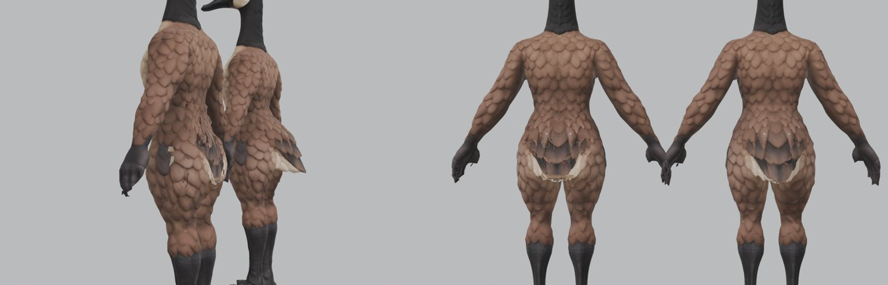

# Garment body: no tail under the clothes (2026-11-07)

Pete: "That tail on the base image really costs time in these outfits; we need a permanent foundational fix: hide the
tail entirely when dressed and have the back of the dressed geese look more human-like where the tail is."


(Side view: left = garment body, right = base goose. Rear view: left = base, right = garment body.)

## What it is
`scripts/make_garment_body.py` writes `out/base-goose/garment_body.npz`: the base goose's game mesh, same vertices in
the same order (bones, weights and every per-vertex table still match), with the back of the hips reshaped:
1. each 1 cm height band through the hips is filled out to its convex hull at the back (cloth spans the hollow under
   the tail root instead of caving into it);
2. the tail's vertices (dominant bone = Tail, the same rule the dresser hides by) are pressed onto that surface;
3. two rounded cheeks are added, the zone relaxed, and nothing but the tail ever ends up inside the real body.

```
blender -b --factory-startup --python scripts/make_garment_body.py -- --relax 30 [--render]
```

## Where it is used
- `make_garment.py` builds every garment on it (chars json `"garment_body": false` opts out). Every outfit built
  before 2026-11-07 was tuned on the real rump and has `"garment_body": false` set (outfit_male, outfit_female,
  both cyclists, both Victorians, both Georgians, grandma, grandpa): their per-outfit `seat_shape` settings would
  double up if rebuilt on the garment body as they are. Rebuilding one on it = drop the flag, drop/retune
  `seat_shape`, rebuild, review (Tandemonium #635).
- `make_robot_parts.py` (robot outfit, branch `feat/robot-outfit`) fits its parts to it.
- `dress_goose.py`:
  - matches a garment's covered-vertex list against the garment-body positions too;
  - hides the tail plus **7** rings of rump faces round it (was 2) under breeches, coats and dresses
    (`"tail_rings"` per character).

  Both only when the outfit is on the garment body: with `"garment_body": false` the dresser behaves exactly as
  before (covers matched on the real rump, 2 tail rings).

  So in the game the real tail is never drawn under the clothes, and the clothes' seat is a person's seat.
- `tools/threejs_check/prop_check.mjs` hides `<piece>__<a+b>` sub-meshes like the game, so game-lit reviews no longer
  show the tail and feet that are hidden in the game.

## First outfit on it
The robot outfit (`docs/robot-outfit.md`): no seat_shape hacks, no tail poking through.
