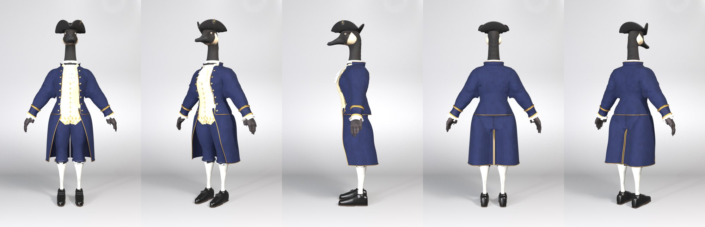
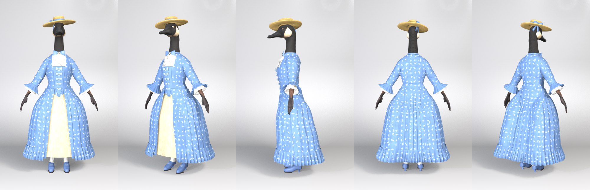

# Georgian (18th-century) pair, from text-to-image references (2026-10-15)

**Pete's brief:** a new male and female outfit for the 18th century. His references (`refs/*/pete_refs/`): Poldark's black
tricorne, and a museum grid of 1740s–1770s English gentlemen's suits and robes à l'anglaise.

**References:** `refs/outfit_<male|female>_georgian/t2i_prompt.json`. Three fronts per outfit (`docs/img/georgian_*_fronts.jpg`);
Pete picked **seed 21** for both. The side views come from `t2i/key1`. The female rear came out as a second front, so her
back was judged on plausibility.
Pete asked that the lady's neck accessory be **its own piece that can be recoloured or swapped**: `bowtie` with the collar
and wings dropped is a ribbon choker.

| Gent (`outfit_male_georgian`), round 7 | Lady (`outfit_female_georgian`), round 21 |
|---|---|
|  |  |

## Gent
**Outfit:**
- **Hat:** black tricorne with a braided edge and a cockade (pleated rosette, gilt button and loop).
- **Neckwear:** linen stock and a three-tier lace jabot.
- **Coat:** navy frock coat. Gold braid, a standing collar, 14 gilt buttons, deep braided cuffs and lace ruffles at the wrists.
- **Waistcoat:** cream, with gold sprigs.
- **Breeches:** navy, with buckled knee bands.
- **Legs and feet:** white stockings and black shoes with square silver buckles.

**Build:**
```
CHAR=outfit_male_georgian bash scripts/build_cyclist.sh breeches shirt waistcoat socks boots hat jabot
bash scripts/build_georgian_coat.sh          # coat body + coatskirt + braid/collar/cuffs/buttons/lining + lace cuffs
dress_goose.py --char outfit_male_georgian --tag full --variant withshoes
```
- **Coat** = the body down to the hips (`make_garment` kind coat) plus `coatskirt` (`make_skirt.py` with `opening`: a
  cutaway front and a back vent that parts over the saddle). A knee-length coat built from the body splits round each
  leg below the crotch.
- **Tricorne** = `make_hat.py` `tricorne`: the brim is folded up along three straight lines, so the walls meet in sharp
  corners. `angle_back_deg` leans the back wall out. Seen edge-on, a vertical back wall reads as a spike.

## Lady
**Outfit:**
- **Hat:** straw boater-crowned bergère hat with a blue band and a puffed ribbon bow at the back-left.
- **Choker:** blue ribbon choker with a bow, tails, a faceted jewel and a pearl drop. It is a separate piece.
- **Fichu:** a muslin kerchief crossing under the choker.
- **Bodice:** damask, with a stomacher of five modelled satin bows, each carrying a jewel.
- **Sleeves:** end at the elbow, with blue flounces over two tiers of lace.
- **Gown:** open over a cream petticoat, pleated into a bell, with a gathered hem flounce.
- **Legs and feet:** white stockings and blue Louis-heel shoes with silver buckles.

**Build:**
```
CHAR=outfit_female_georgian bash scripts/build_cyclist.sh jacket petticoat skirt socks boots hat bowtie fichu
make_cuffs.py --char outfit_female_georgian --from jacket --name cuffs ; ... --name lace
dress_goose.py --char outfit_female_georgian --tag full --variant withshoes
```

## New tools (all recipe-driven)
- **`pattern_paint.py`:**
  - `sprig` (damask / embroidery). Use `lattice: "3d"` on wide skirts: the angle × radius coordinate shears the back
    into streaks.
  - `panels`: painted regions, such as the fichu fill and the stomacher.
- **`make_skirt.py`:**
  - `opening` (front cutaway and back vent, with clean edges by respacing each row).
  - `over` (stay outside a shell). The bodice back covers the rump, so the skirt must clear it.
  - Tier `uniform` / `span_deg` for an all-round hem flounce.
  - `flounce.geo_amp`.
- **`make_hat.py`:** `tricorne`, `cockade`, `ribbon_bow`, `tilt_deg` and `tilt_side_deg`. Style `top` with flare 1.0 gives a boater crown.
- **`make_boot.py`:** `arch` gives a Louis heel. The goose's feet can't go below the floor, so the arch lifts the back of the shoe onto a waisted heel.
- **`make_accessory.py`:**
  - bowtie `tails`, `jewel` (faceted stone, gilt setting, pearl `drop`);
  - `neckband_h`, `bow_rough`.
- **`make_cuffs.py`:** `--name` for a second frill, `thick`, `tiers` (a negative `tier_step` goes down the arm) and `lace_tex`.
- **New scripts:** `make_jabot.py` (jabot, or `--piece fichu` with crossing strips and a front-only band), `add_bows.py` (modelled bow trims with jewels) and `add_shoe_buckle.py`.
- **`dress_goose.py`:** chars json keys `loose_pieces`, `no_mask` and `rigid`.

Reviews: reviewer agents scored the gent 5/10 at round 6, and the lady 6/10 at rounds 8 and 11. Pete approved both at rounds 7 and 21 ("looks pretty good").
