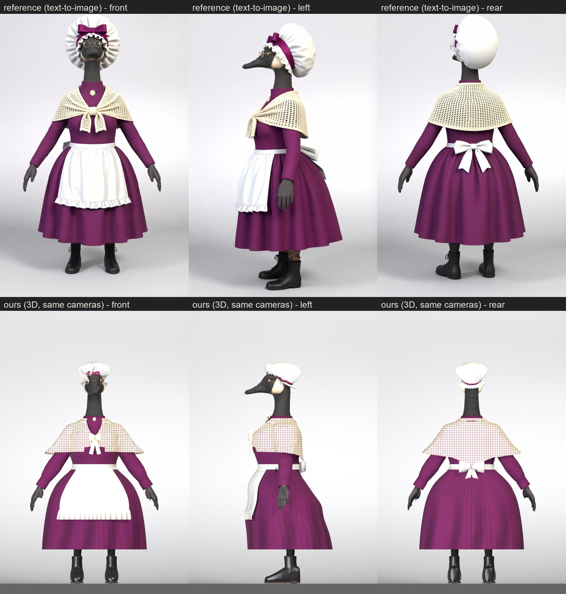
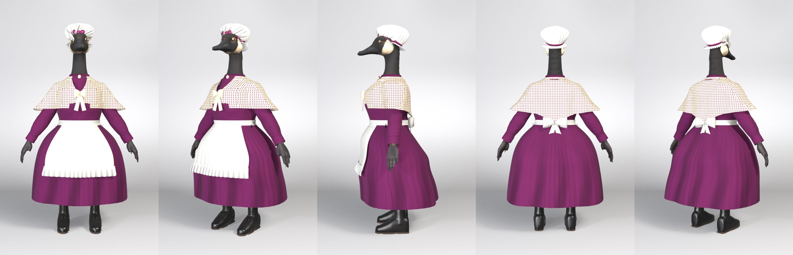

# Grandma (Victorian grandmother), from text-to-image references (2026-10-22)

**Pete's brief:** a grandma and grandpa goose, "shorter and wider". He picked concept A for her (at home) and the mob
cap with the plum ribbon from six hat options. References: `refs/outfit_grandma/t2i/key1c/` (the picked outfit restaged
on her shaped body in the key cameras; the image model's invented tail removed with `t2i_cleanup.py`).

| Ours vs the references (same cameras) | Beauty |
|---|---|
|  |  |

**Outfit:**
- **Cap:** white cotton mob cap: puffy gathered crown, ruffled frill all round, plum satin ribbon with a bow at the front.
- **Spectacles:** small round gold wire, Grandpa's `make_spectacles.py` with his settings.
- **Dress:** plum wool, high stand collar with an oval cameo, long sleeves, full gathered skirt to mid-calf.
- **Shawl:** cream filet crochet over the shoulders, knotted at the front with two hanging ends, a point at the back.
- **Apron:** white cotton front panel with a ruffled hem; a waistband all round tied in a big bow at the back.
- **Legs and feet:** black stockings and black lace-up ankle boots.

**Result:** `out/outfit_grandma-goose/outfit_grandma_full_dressed.glb`, rigged and skinned with all the clips.
glTF validator 0 errors / 0 warnings; three.js r161 ok; the honk opens the beak and shows the tongue
(`docs/img/grandparents/grandma_honk_threejs.jpg`). Pose sheet (incl. seated): `grandma_poses.jpg`.

## Body
- `chars/outfit_grandma.json` `shape`: arm 0.8, torso 1.25, hip 1.4, leg girth 0.95, leg length 0.85, height 0.9,
  leg pitch 3 (about 1.41 m against the young pair's 1.74 m).
- **Build frame:** `build_frame_lift` is **-0.0748**: her short legs leave the soles *above* z = 0 before dress_goose
  moves them to the floor (the ladies' is +0.0932). All recipe heights are in that frame. `make_boot` `z_off` +0.0748.
- **Joints:** `out/outfit_grandma-goose/joints.json` = the slider joints in the build frame (pattern_paint's
  `joints_file`). Her heights are not the ladies' scaled: hip 0.664, waist (Spine) 0.791, neck 1.173, head 1.355.

## Build
```
CHAR=outfit_grandma bash scripts/build_cyclist.sh socks boots jacket skirt apron apronband bowtie shawl hat
blender ... make_spectacles.py -- --char outfit_grandma
blender ... shell_to_shape.py -- --char outfit_grandma --piece spectacles --fresh
blender ... dress_goose.py -- --char outfit_grandma --tag full --variant withshoes
CHAR=outfit_grandma REF=key1c CLOSEA=1.25,0.5 CLOSEB=0.62,0.7 CLOSEC=0.2,0.4 bash scripts/review_cyclist.sh <tag>
```
- **jacket** (bodice): the Victorian lady's jacket recipe closed (no V, no lapels), high neck, plum. Tucked into the
  skirt (`tuck`, `x_max` 0.3 for her wider torso). `hem_points.z_back` 0.845 raises the back hem over the hidden tail
  root, whose rim had poked through as a jagged flap.
- **skirt:** `make_skirt.py`, full bell profile, soft gathers (`pleats` 52 x 4.5 mm), `close_az` 8.
- **apron:** `make_skirt.py` with the new `panel` (each row spans only +-a(z) across the front) over the skirt, and a
  hem frill = one tier with the new `center_deg` 0. It follows the skirt's front cloth chains (`follow_inner`), so it
  lies on the lap when seated.
- **apronband:** a narrow `make_skirt` band at the waist; `add_bows.py` puts the big bow on the back (`from: back`,
  `axis_normal`).
- **bowtie** = the stand collar + cameo: `make_accessory --piece bowtie` with the bow, knot, wings, shirt front and
  neck band dropped, and the new `jewel.on_collar` / `aspect` / `backing` / `smooth` (an oval cameo: gilt frame, rose
  ground, ivory relief).
- **shawl:** `make_skirt.py` lofted round the body *including the arms* (new `radius_arms`), `opening` for the front
  V that closes at the knot, new `hem_az` (hem height by azimuth: the point at the back). Painted with the new
  `crochet` pattern (tri-planar filet mesh, the holes painted the dress colour). Front knot = a second `bow_trims`
  entry (bow_trims may now be a list, one per piece).
- **hat:** new `make_mobcap.py` (recipe `mobcap_design`). It fits the character's own naked shaped head (not the base
  head, as make_cloche does): a band tilted up at the front, a puffed crown with gathers, a frill whose droop varies by
  azimuth (lifted off the face at the front), the ribbon band placed by distance along the crown (by height it smeared
  over the near-flat front of the crown in three.js), and a flat two-lobe bow standing off the band.

## Shared-script changes (all off by default: existing characters build the same; Georgian choker rebuilt identical)
- `make_skirt.py`: `panel`, tier `center_deg`, `close_az`, `radius_arms`, `hem_az`.
- `add_bows.py`: `from: back`, `axis_normal`, list-valued `bow_trims` (`--piece` picks).
- `make_accessory.py`: `jewel.on_collar`, `aspect`, `backing`, `smooth`.
- `pattern_paint.py`: `crochet`.
- `dress_goose.py`: empty covers file skipped (an apron covers no body); chars json `follow_inner` / `inner_top`.
- `build_cyclist.sh`: apron / apronband / shawl -> make_skirt; `mobcap_design` -> make_mobcap; bow_trims per piece.
- `review_cyclist.sh`: `REF` and `CLOSEA/B/C` overrides.
- Gotcha: `opening.front` / `panel.front` tables must be in **ascending z** (np.interp); written top-down, the shawl's
  front opening landed at the back.

## Rounds (r1-r23, `renders/cyclist/outfit_grandma/`)
r1 bodice hem stuck out as a hoop over the skirt -> skirt over the bodice, tucked. r2-r5 jagged flap at the back waist
= the bodice hem over the tail root -> back hem raised. r6-r8 apron, band, back bow (bow was buried: casting from the
front; then tilted by a fold -> `axis_normal`; notch at the centre back -> `close_az`). r9-r10 collar + cameo.
r11-r15 shawl (opening order bug, crochet scale, knot). r16-r21 mob cap + spectacles. r22-r23 gathers, apron fabric,
seated apron (follow_inner), three.js cap fixes (wire-ring bow -> flat lobes; ribbon smear).

## Limits / next
- The cap is smaller and sits higher than the reference's oversized pouf (the image model enlarged it; sized to the
  head). The crochet is a painted mesh, not open holes; from a distance it reads as a small check.
- The shawl's knot ends are short ribbons, not the knitted ends of the reference; the shawl is a cape (the arms
  flare it when raised: see the seated pose).
- Gloveless mitt hands (D8). Not ride-fitted (no `ride_fit` / delivery / game integration yet).
