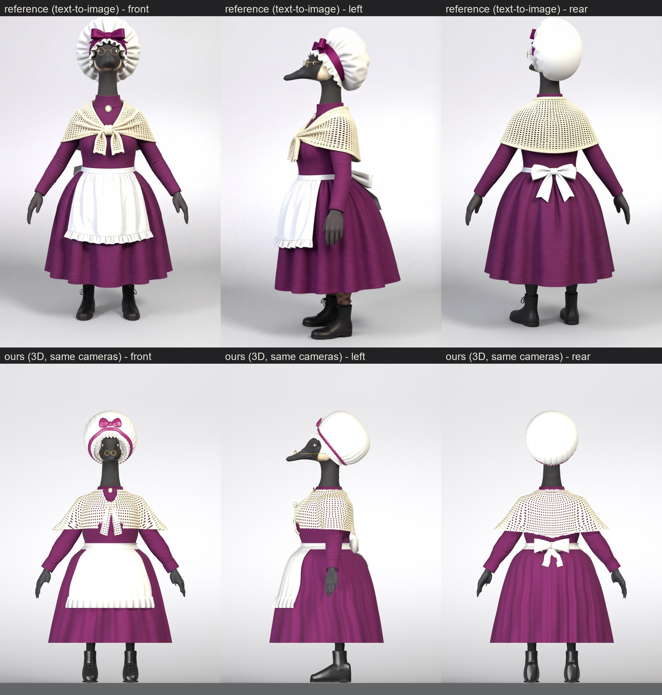
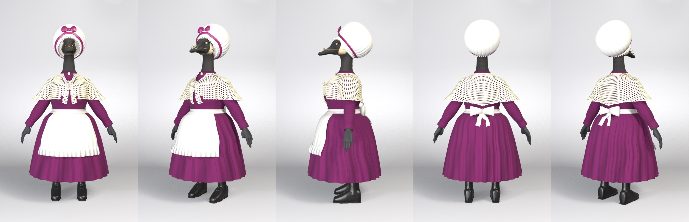

# Grandma (Victorian grandmother), from text-to-image references (2026-10-22)

**Pete's brief:** a grandma and grandpa goose, "shorter and wider". He picked concept A for her (at home) and the mob
cap with the plum ribbon from six hat options. References: `refs/outfit_grandma/t2i/key1c/` (the picked outfit restaged
on her shaped body in the key cameras; the image model's invented tail removed with `t2i_cleanup.py`).

| Ours vs the references (same cameras), round 2 | Beauty |
|---|---|
|  |  |

Close-ups: `grandma_head_final.jpg` (spectacles down the bill, side view), `grandma_closeups_final.jpg` (cap, shawl,
knot, apron tie), `grandma_poses_final.jpg` (three.js poses incl. riding), `grandma_honk_threejs.jpg`. The first build's
sheets (`grandma_ref_vs_ours.jpg`, `grandma_beauty.jpg`, ...) are kept for comparison.

**Outfit:**
- **Cap:** a big white cotton mob cap: a gathered pouf over the back of the head (about 0.31 m across, like the
  reference's), a ruffled frill framing the face, plum satin ribbon behind the frill, a plum bow at the top front.
- **Spectacles:** small round gold wire reading glasses perched down the bill (Grandpa's `make_spectacles.py`
  `perch` mode, his values).
- **Dress:** plum wool, high stand collar with an oval cameo, long sleeves, full gathered skirt to mid-calf.
- **Shawl:** cream filet crochet with real open holes (alpha-clipped), worked in rounds from the neck, a solid
  scalloped edge; knotted at the front with a crochet knot and two wide crochet ends.
- **Apron:** white cotton front panel with a ruffled hem; a waistband all round tied in a big bow at the back.
- **Legs and feet:** black stockings and black lace-up ankle boots (black soles, laces up the shaft).
- **Hands:** bare, as the reference: the body texture's hand texels recoloured an even charcoal (`hand_tint`).

**Result:** `out/outfit_grandma-goose/outfit_grandma_full_dressed.glb`, rigged and skinned with all the clips.
glTF validator 0 errors / 0 warnings; three.js r161 ok; the honk opens the beak and shows the tongue
(`docs/img/grandparents/grandma_honk_threejs.jpg`). Pose sheet (incl. seated): `grandma_poses.jpg`.

## Body
- `chars/outfit_grandma.json` `shape`: arm 0.8, torso 1.25, hip 1.4, leg girth 0.95, leg length 0.85, height 0.9,
  leg pitch 3 (about 1.41 m against the young pair's 1.74 m).
- **Build frame:** `build_frame_lift` is **-0.0748**: her short legs leave the soles *above* z = 0 before dress_goose
  moves them to the floor (the ladies' is +0.0932). All recipe heights are in that frame. `make_boot` `z_off` +0.0748.
- **Joints:** `out/outfit_grandma-goose/joints.json` = the slider joints in the build frame (pattern_paint's
  `joints_file`). Her heights are not the ladies' scaled: hip 0.664, waist (Spine) 0.791, neck 1.173, head 1.355.

## Build
```
CHAR=outfit_grandma bash scripts/build_cyclist.sh socks boots jacket skirt apron apronband bowtie shawl hat
   # (shawl: pattern_paint, then add_shawl_knot.py; apronband: add_bows.py)
blender ... make_spectacles.py -- --char outfit_grandma
blender ... shell_to_shape.py -- --char outfit_grandma --piece spectacles --fresh
blender ... dress_goose.py -- --char outfit_grandma --tag full --variant withshoes
CHAR=outfit_grandma REF=key1c CLOSEA=1.25,0.5 CLOSEB=0.62,0.7 CLOSEC=0.2,0.4 bash scripts/review_cyclist.sh <tag>
```
- **jacket** (bodice): the Victorian lady's jacket recipe closed (no V, no lapels), high neck, plum. Tucked into the
  skirt (`tuck`, `x_max` 0.3 for her wider torso). `hem_points.z_back` 0.845 raises the back hem over the hidden tail
  root, whose rim had poked through as a jagged flap.
- **skirt:** `make_skirt.py`, full bell profile, soft gathers (`pleats` 52 x 4.5 mm), `close_az` 8.
- **apron:** `make_skirt.py` with the new `panel` (each row spans only +-a(z) across the front) over the skirt, and a
  hem frill = one tier with the new `center_deg` 0. It follows the skirt's front cloth chains (`follow_inner`), so it
  lies on the lap when seated.
- **apronband:** a narrow `make_skirt` band at the waist; `add_bows.py` puts the big bow on the back (`from: back`,
  `axis_normal`).
- **bowtie** = the stand collar + cameo: `make_accessory --piece bowtie` with the bow, knot, wings, shirt front and
  neck band dropped, and the new `jewel.on_collar` / `aspect` / `backing` / `smooth` (an oval cameo: gilt frame, rose
  ground, ivory relief).
- **shawl:** `make_skirt.py` lofted round the body *including the arms* (new `radius_arms`), `opening` for the front
  V that closes at the knot, new `hem_az` (hem height by azimuth: the point at the back). Painted with the new
  `crochet` pattern (tri-planar filet mesh, the holes painted the dress colour). Front knot = a second `bow_trims`
  entry (bow_trims may now be a list, one per piece).
- **hat:** new `make_mobcap.py` (recipe `mobcap_design`). It fits the character's own naked shaped head (not the base
  head, as make_cloche does): a band tilted up at the front, a puffed crown with gathers, a frill whose droop varies by
  azimuth (lifted off the face at the front), the ribbon band placed by distance along the crown (by height it smeared
  over the near-flat front of the crown in three.js), and a flat two-lobe bow standing off the band.

## Shared-script changes (all off by default: existing characters build the same; Georgian choker rebuilt identical)
- `make_skirt.py`: `panel`, tier `center_deg`, `close_az`, `radius_arms`, `hem_az`.
- `add_bows.py`: `from: back`, `axis_normal`, list-valued `bow_trims` (`--piece` picks).
- `make_accessory.py`: `jewel.on_collar`, `aspect`, `backing`, `smooth`.
- `pattern_paint.py`: `crochet`.
- `dress_goose.py`: empty covers file skipped (an apron covers no body); chars json `follow_inner` / `inner_top`.
- `build_cyclist.sh`: apron / apronband / shawl -> make_skirt; `mobcap_design` -> make_mobcap; bow_trims per piece.
- `review_cyclist.sh`: `REF` and `CLOSEA/B/C` overrides.
- Gotcha: `opening.front` / `panel.front` tables must be in **ascending z** (np.interp); written top-down, the shawl's
  front opening landed at the back.

## Rounds (r1-r23, `renders/cyclist/outfit_grandma/`)
r1 bodice hem stuck out as a hoop over the skirt -> skirt over the bodice, tucked. r2-r5 jagged flap at the back waist
= the bodice hem over the tail root -> back hem raised. r6-r8 apron, band, back bow (bow was buried: casting from the
front; then tilted by a fold -> `axis_normal`; notch at the centre back -> `close_az`). r9-r10 collar + cameo.
r11-r15 shawl (opening order bug, crochet scale, knot). r16-r21 mob cap + spectacles. r22-r23 gathers, apron fabric,
seated apron (follow_inner), three.js cap fixes (wire-ring bow -> flat lobes; ribbon smear).

## Round 2 (r24-r30, 2026-10-23): Pete's review of the first build
Pete asked for every listed flaw fixed, the glasses further down the beak, and iteration against the reference.
- **Cap** (`make_mobcap.py` rewritten): the face opening is where a plane tilted back crosses the head (`rim_front` /
  `rim_back`); the pouf is a superellipsoid dome about that plane's normal (`rx`, `re`, `h`, set back `d`), so it
  overhangs the gathered rim like a ball with the face hole at its front. Each lip point clears the head by `lip_gap`.
  Gathers are rounded puffs between creases (`gathers`, `gather_amp`, `gather_reach`). The frill grows from the dome's
  lip, forward over the face (`frill_fwd`, `frill_out`), ruffled along its own normal (not in its plane: that made a
  saw-tooth), narrowed where it would cover the eyes (`frill_side`, `frill_side_at` 45 deg). The ribbon is smoothed
  over the gathers; the bow is two pillow lobes with satin creases + a knot (no tails: they floated). The clearance
  pass ignores the catchlight planes (their back faces pushed points 8 cm out as spikes). 59k tris.
- **Crochet** (`pattern_paint.py`, opt-in on the `crochet` pattern): `alpha_holes` (alpha-clipped holes: glTF MASK,
  double-sided, Image alpha -> Round -> BSDF alpha), `map: cone` (rounds from an `apex` above the neck, column count per
  `group` of rounds from that group's mean girth: no tri-planar seams), `hole_round`, `tube` (round-yarn shading),
  and `bands` are solid in open-work, with a `scallop`ed outer edge.
- **Knot** (new `scripts/add_shawl_knot.py`, recipe `shawl_knot`, run by build_cyclist.sh after the shawl's pattern):
  a two-lobed pinched knot with twisted folds and two wide single-layer crochet ends lying on the bodice, a tiling
  one-cell crochet texture (ends alpha-clipped, knot solid with dark holes). The shawl's front V closes higher (1.095).
- **Skirt** (`make_skirt.py`, opt-in): `bell` (a bell from the waist's own radius to hem radii, `power` 0.45 = early
  flare; `plumb` hangs it from the waist's centre -- the body centre drifts 73 mm back with her pitched legs, which
  slanted the skirt) and `pleats.shape: wave` (soft gathered folds, 26 round, on `na` 240 so they are sampled).
  The lampshade shelf at the hips and the knife pleats are gone. Seated (three.js riding pose) it no longer balloons.
- **Apron tie:** bigger bow (0.2 m), tails lean out over the skirt (`add_bows.py` opt-in `tail_out`, `clear_of`
  [skirt]); the shawl's back point raised so the bow shows.
- **Bodice:** hem raised to 0.80 inside the skirt (its side poked out under the apron band as a dark wedge).
- **Hands** (`dress_goose.py` opt-in `hand_tint`): a copy of the body colour map, Hand-skinned texels recoloured
  charcoal with the texture's light/dark kept (creases); a glove shell was tried and rejected (a mitten, no fingers).
- **Boots:** `make_boot.py` opt-in `sole_rgb` (black soles), rounder toe, lighter laces and dark eyelets.
- `make_garment.py` opt-in `fill_misses` (black bake-miss texels filled from neighbours) -- not the dark wedge's cause
  in the end, kept on for the skirt.
- Compatibility: the Georgian lady's skirt, jacket (bows) and boots rebuilt: vertex-identical, textures equal.

## Limits / next
- The shawl is still a cape (no drape over the forearms when they reach forward); the T-pose shows the bodice's
  armpit cloth as wings (not a game pose).
- Far away (mip-mapped) the crochet holes close up in three.js and the shawl reads as a cream dot pattern.
- The hands keep the base goose's mitt shape and claw tips; only their colour changed.
- 36.6 MB GLB (2048 textures per piece). Not ride-fitted (no `ride_fit` / delivery / game integration yet).
