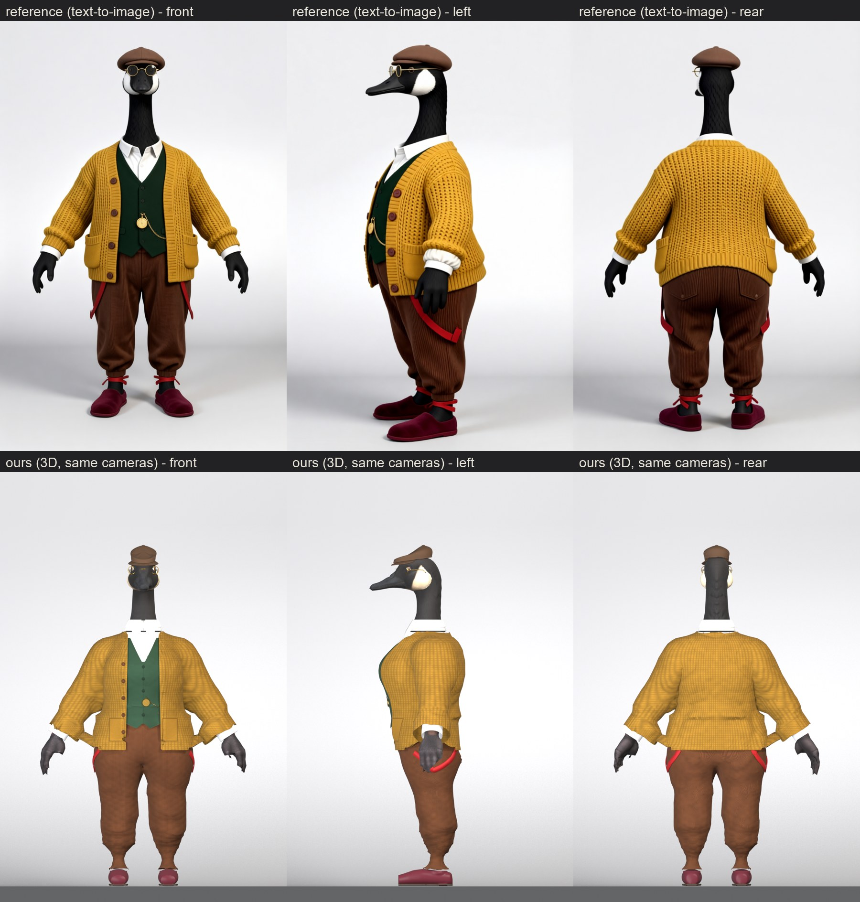

# Grandpa goose (Victorian grandfather at home), from text-to-image references (2026-10-22)

Pete asked for a grandma and grandpa goose, "shorter and wider", and picked concept A for Grandpa:
- brown wool flat cap and round gold wire spectacles;
- white shirt with a soft collar;
- dark green waistcoat with a gold pocket watch and chain;
- chunky mustard cardigan worn open, with brown buttons and two patch pockets;
- brown corduroy trousers, loose and gathered at the ankle, with red braces worn dropped;
- burgundy velvet carpet slippers.

Grandma is the partner outfit, in [grandma-outfit.md](grandma-outfit.md).

**Result:** `out/outfit_grandpa-goose/outfit_grandpa_full_dressed.glb`. It is rigged and skinned with all the clips:
- glTF validator: 0 errors, 0 warnings;
- three.js r161: loads and plays every clip;
- honk: opens the beak and shows the tongue.

Sheets are in `docs/img/grandparents/grandpa_*` (reference vs ours, beauty, poses, head, honk).



## Body
`chars/outfit_grandpa.json` "shape" (sliders): arm girth 1.1, torso 1.35, hips 1.3, leg girth 1.15, leg length 0.85,
height 0.93. He stands about 1.45 m, against 1.74 m for the young pair.
- **Build frame:** the slider body before dress_goose sets the soles on the floor. Upper-body heights are the base
  goose's × 0.93, and the soles sit at z +0.0829. The dressed lift is −0.079, because the slippers are the lowest point.
- **Joints:** `scripts/char_joints.py --char outfit_grandpa --lift -0.0829` writes `out/outfit_grandpa-goose/joints.json`
  (the recipe's `joints_file`) and prints landmark heights in both frames.
- **References:** `refs/outfit_grandpa/t2i/key1c`. These are the key-camera restage (`key1`) with the tails the image model kept adding
  removed by `t2i_cleanup.py`.

## Build
```
CHAR=outfit_grandpa bash scripts/build_cyclist.sh breeches shirt waistcoat cardigan necktie boots hat
blender ... scripts/shell_to_shape.py -- --char outfit_grandpa --piece hat --fresh
blender ... scripts/make_spectacles.py -- --char outfit_grandpa
blender ... scripts/shell_to_shape.py -- --char outfit_grandpa --piece spectacles --fresh
blender ... scripts/dress_goose.py -- --char outfit_grandpa --tag full
CHAR=outfit_grandpa REF=key1c REST=1 RDIR=renders/grandpa bash scripts/review_cyclist.sh <tag>
```

### Pieces
- **Trousers** (piece name `breeches`, which dress_goose's layer rules expect): `make_garment` kind breeches, from the waist to just inside the slipper.
  - Straight wide legs come from `min_r` 0.095 between z 0.24–0.56. With ease alone the legs followed the goose's thick thigh, thin
    knee and full calf, coming out jodhpur-shaped and then pantaloon-shaped.
  - The new `min_r_smooth` 40 removes the 1 cm ring ripples.
  - A soft gathered band sits at the ankle.
  - Corduroy is the `rib` pattern, with vertical wales down each leg.
- **Braces**: the new `scripts/add_trims.py --kind braces` joins red straps into the trouser shell, so they are skinned with it. Per side, one strap
  runs from a clip on the front waistband, round the outside of the thigh, up to a clip on the back. They are worn dropped, as in the reference.
- **Shirt**: the cyclist's shirt with heights × 0.93, tucked in. **Collar**: `make_accessory --piece necktie` with the new
  `no_tie` (just the turned-down collar).
- **Waistcoat**: kind vest (the Victorian gent's, × 0.93):
  - five buttons, no lapels, pointed front;
  - the back hem is raised to 0.90, because at 0.83 it poked out through the cardigan over the tail root.
  - **Pocket watch:** `add_trims.py --kind fob` adds a domed gold case, crown and bow, and a chain sagging to the watch pocket.
- **Cardigan**: kind shirt (from the lady cyclist's cardigan):
  - `knit` ribbed hem, cuffs and front bands;
  - the new `v_neck.bot_w` makes an open front;
  - `seat_fit` and `seat_bump` shape the back over the tail root;
  - `over` [shirt, waistcoat, breeches]: shirt-kind garments now keep `clear` outside the listed shells, as the vest does. Without it,
    the trouser waist poked through at the hips.
  - **Paint:** the `rib` pattern with the new `waffle` (horizontal ridges × ribs for a chunky knit); brown `buttons` on the wearer's right front edge
    (the new `buttons.x` / `buttons.z`); patch pockets as painted `panels`.
- **Slippers**: `make_boot` (the cyclist's last scaled to his foot, `z_off` 0.0829): a low, rounded, flat shoe in burgundy velvet.
- **Cap**: `make_cap` with the cyclist's own base-head values (band 1 cm higher, plain brown wool), carried to his head by the
  new `scripts/shell_to_shape.py`. His head is the base head × 0.93 about the origin, so a base-fitted hat fits exactly.
- **Spectacles**: the new `scripts/make_spectacles.py`, also built on the base head and carried by `shell_to_shape.py`.
  It is rigid on Head (`"rigid": {"spectacles": "Head"}`, `"no_mask": ["spectacles"]`).

## Review rounds (r1 → r9, key cameras vs `key1c`)
- **r1:** cardigan and waistcoat hems were chewed by layer masks from the trousers and braces (`layer_ignore`), and there
  was a see-through gap between cuff and slipper (cuff lowered into the slipper).
- **r2–r3:** the braces vanished because a carriage return broke the build hook. Jodhpur thighs and thin calves.
- **r4:** the spectacle bridge ran over the crown under the cap; it now crosses the front of the face. Collar gaps were narrowed.
- **r5–r6:**
  - straight legs (`min_r`) and the waffle knit;
  - the "hole" in the cardigan back was inner layers poking out at the tail root, fixed by the waistcoat back hem and the cardigan's
    `seat_fit`.
- **r7–r9:** extra torso ease brought back poke-through, so it was reverted. Shirt-kind `over` clearance fixed it for good.

## Remaining flaws
- **Collar:** the stand still shows thin dark slits at the front opening and under the falls in close-ups.
- **Knit:** reads a little like a fine check from a distance. The reference's cable/waffle has real relief (ours is
  paint plus the knit detail bake).
- **Sleeves:** fuller than the reference's.
- **Pockets:** painted, not modelled.
- **Ankles:** no red ankle ties (the reference's ankle ties look like the image model echoing the braces).
- **Spectacles from the front:** they sit beside the head (a goose's eyes are on its sides), so they read best in 3/4 and profile.

## Shared-script changes (all opt-in by recipe key; existing characters build as before)
| Script | Change |
|---|---|
| `make_garment.py` | `v_neck.bot_w` (default 0); `min_r_smooth` (default 4); shirt kind honours `over` (no existing shirt-kind recipe has `over`) |
| `pattern_paint.py` | `buttons.x` (default 0) / `buttons.z`; rib `waffle` |
| `make_accessory.py` | necktie `no_tie` (the knot + blade are only indented under the flag) |
| `build_cyclist.sh` | knee straps only when the recipe has `kneestrap` (the cyclist and Georgian do); `add_trims.py` hook for `fob` / `braces` |
| `review_cyclist.sh` | `REST=1` (render the rest pose), `RDIR=` (output folder) |
| new | `char_joints.py`, `shell_to_shape.py`, `make_spectacles.py`, `add_trims.py` |
