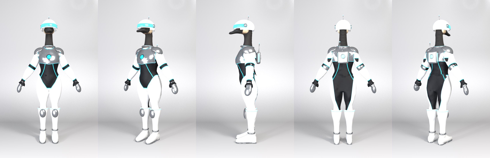
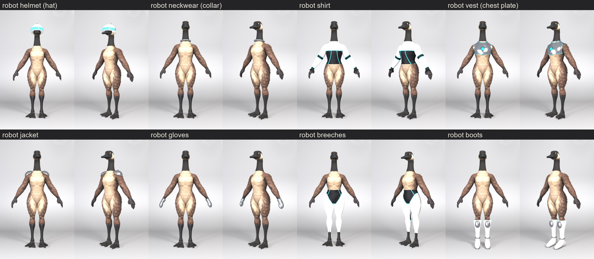

# Robot outfit (male), for the player-bots Canada Goose bot (Tandemonium #611), 2026-11-07

Pete picked look **A2 chrome** (seed 7: white plates, black suit, blue light lines) from
`docs/img/robot/robot_fronts.jpg` and the **visor** helmet from `docs/img/robot/helmet_examples.jpg`. The base goose
already has the Canada Goose head (black head and neck, white cheek), so the bot is the goose in this outfit.

| Full outfit, v7 | Each piece alone |
|---|---|
|  |  |

Poses: `docs/img/robot/robot_poses_v7.jpg` (the riding pose: caps follow the arms, knee caps the shins).
Reference vs ours: `docs/img/robot/robot_review_v7.jpg`.

## Pieces (Pete: reusable, classified like the other outfits)
| Piece (mesh name) | What's in it | Built by |
|---|---|---|
| robot helmet (`hat`) | white dome fitted round the skull, open underneath so the beak is free (honk works), glowing visor band, chrome rims, ear discs with light rings, antenna | `make_robot_parts.py` (rigid on Head) |
| robot neckwear (`collar`) | chrome ring with a light line round the base of the neck | `make_robot_parts.py` (rigid on Spine2) |
| robot shirt (`shirt`) | black top, white arm plates, black elbow and wrist bands, light lines; tucked into the breeches so no gap shows | `make_garment.py` shirt + `pattern_paint.py` robotsuit |
| robot vest (`waistcoat`) | chrome chest plate, high round neck, light core | `make_garment.py` vest (knit path, no ribs) + robotplate |
| robot jacket (`jacket`) | shoulder caps, elbow caps, back power pack (white panel, light core, light side strips), antenna | `make_robot_parts.py`; each part on its own bone |
| robot gloves (`gloves`) | chrome mitts, joint grooves, black cuff with a light line, light on the back of the hand | `make_garment.py` glove + robotglove |
| robot breeches (`breeches`) | black high-cut "leotard" over the seat, white legs, light lines along the cut | `make_garment.py` breeches + robotsuit |
| robot boots (`boots`) | Victorian knee-boot last in white enamel, chrome sole and ankle band, light ring at the top, chrome knee caps | `make_boot.py` + `make_robot_parts.py` |

## Build
```
CHAR=outfit_male_robot bash scripts/build_robot.sh      # everything, then review renders in renders/robot/
bash scripts/dress_singles.sh outfit_male_robot          # each piece alone on the naked goose
```
Recipe: `chars/outfit_male_robot.json` (garment_design, patterns, boot_design, robot_parts, rigid, no_mask).
Output: `out/outfit_male_robot-goose/outfit_male_robot_full_dressed.glb` (21 MB, glTF validator 0 errors / 0 warnings)
and `..._only_<piece>_dressed.glb`.

## New in the tools
- `pattern_paint.py`:
  - types `robotsuit` (plates by limb: arm arc length from `arm_s`, a leotard cut `z_cut(|x|)` front and back, yoke,
    curved torso lines), `robotglove`, `robotplate` (metal, core, light line along the open edges);
  - light lines go to an **emission texture** (`glow`, `glow_strength`), and `metallic` sets the material's metalness.
    The game lights riders with a RoomEnvironment map, so chrome reflects.
- `make_garment.py`: `"tailoring": false` drops the fly, slit pockets and shirt placket from the detail bake.
- `dress_goose.py`: `<piece>.json` `rigid_parts` [{bone, center, radius}] puts whole mesh islands (centroid within
  radius) on one bone: the jacket's caps and pack, the boots' knee caps.
- `make_robot_parts.py`: the modelled parts. Caps are sphere segments centred on the joint, sized to clear the body
  near it (an earlier per-vertex push followed the garments' inward linings and threw spikes).

## Round 2 (Pete: better chest orb, pack and helmet, silver chrome), v12
- **3D orbs** (`orb_module`): dark housing, two chrome bezel rings, 4 clamps, 12 light segments, a glowing dome with a
  white-hot centre, 3 chrome spokes. On the chest plate (`make_robot_parts.py --pieces vest`, built from
  `versions/waistcoat_preorb.glb`; the painted core is now a dark recess) and on the power pack.
- **Power pack:** chrome body, black seam, white face panel, the orb, 4 vent slats, corner bolts, framed side light
  strips, antenna in a collar, two exhaust ports.
- **Helmet:** clean plane cuts (bottom, and a slant under the visor for the beak) with chrome trim on every edge,
  black inner lining, framed visor with a scan line, a crest with a light line, ear discs (housing, black face, light
  ring, bolt) and vents.
- **Caps** (shoulder, elbow, knee): clean cut edges, chrome trim and a light line.
- **Collar:** two rings (a gorget band) so no feathers show between it and the chest plate.
- **Silver chrome:** a pure mirror rendered nearly black in the game's RoomEnvironment (and the game's 'lean' riders
  light has no env map at all), so chrome = base 0.96, metallic 0.75, roughness 0.24: bright silver in every mode.
  `docs/img/robot/robot_game_v12.jpg` is the game-lit check (`tools/threejs_check/prop_check.mjs`; it shows every body
  part, so the tail and feet poke out there but not in the game).
- The chest plate: no cloth-fold normal map, 8k tris, Laplacian-smoothed; `join(unwrap=False)` (re-unwrapping had
  scrambled its painted texture).

## Round 3 (Pete: foundational tail fix, cut triangles), v17
- Built on the **garment body** ([garment-body.md](garment-body.md)): human-like seat, tail hidden; no feathers through
  the seat (`docs/img/robot/robot_seat_v17.jpg`), game-lit check `docs/img/robot/robot_game_v18.jpg`.
- **Triangles: 83.7k -> 41.9k visible** (the cyclist is 57k). Fewer segments in every generated part (rings, trims,
  domes, orbs), per-piece budgets in `make_robot_parts.py` (hat 6k, collar 1.6k, jacket 8k, boots 7k; collapse-
  decimated when over), chest plate 4.5k, boot last `--tris 4500`. Full GLB 20 MB, validator 0 errors / 0 warnings.

## Open
- The chest plate's back shows faint dents in reflections (it follows the body's back too closely).
- Boots are ~19.6k tris (the knee-boot last is 11.4k); the rings could drop segments.
- The female body version (fit the same recipe to `outfit_female`'s sliders).
- In the game: the Canada Goose bot on the back of Solo Flight (Penny-Farthing) needs this outfit's rider clips.

## Round 4 (Tandemonium #635): rebuilt on the fixed garment body, v19
- Rebuilt both bodies (`build_robot.sh`) on main's garment body. The #45 relax on the welded mesh and the #46 covers
  written on the real rump remove the cracks the v17 shells had: a crumpled seat, a crease at the back waist, and body
  specks through the suit at the hips.
- `tuck.push_in` 0.045 (as the cyclists and the Victorian gent use): the shirt's back is pushed inside the breeches'
  high waist, so the band's clean top edge makes the waistline. Without it, the masked shirt left a sawtooth step
  across the back.
- Before/after: `docs/img/robot/robot_gbody_m_v19.jpg`, `robot_gbody_f_v19.jpg`. Riders in both seats bake at 0 mm
  contact. The Penny-Farthing `Pedal_PF` clips and the show clips re-bake identical, so only the 4 rider GLBs change.
