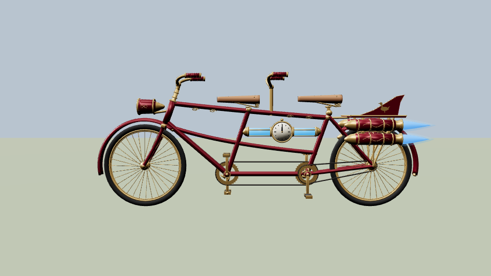
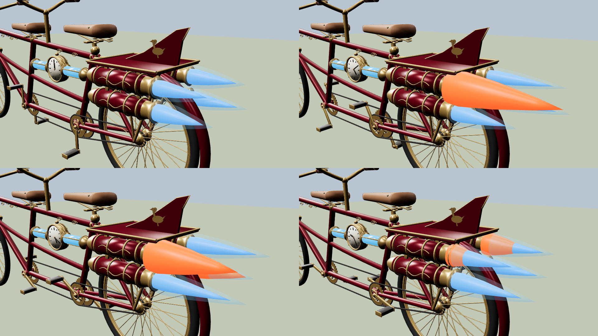
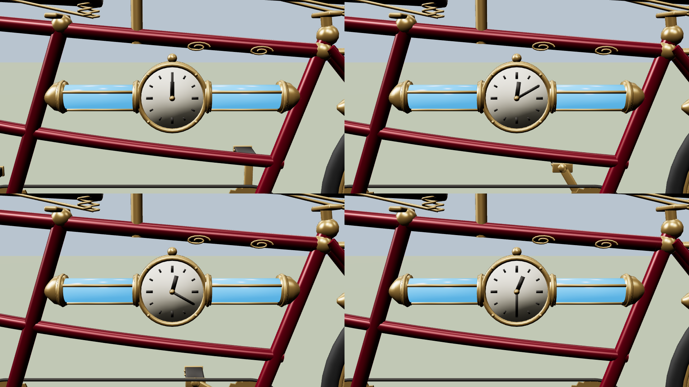

# Time Warp tandem (Tandemonium #611)

Pete's steampunk time-travel tandem, the reward for **any 90 of the 95 non-calendar achievements** (it brings time warp mode).
Concept: `refs/time_warp/pete_refs/concept_01_steampunk_side.png`.



## Build
```
blender -b --factory-startup --python scripts/make_time_warp.py -- [--base <bike_rigged_goosefit26.blend>] [--sheet]
node tools/threejs_check/fx_anim.mjs out/time_warp/time_warp_tandem.glb renders/time_warp/fx   # game-lit MP4/GIF
```
Output: `out/time_warp/time_warp_tandem.glb` (~42k tris, 0.93 MB, glTF validator 0/0) and `_info.json`. The game ships it as
`tandem-3d/goose/time_warp_tandem.glb`.

- **Same rig as the game tandem.** The script opens `out/bike/bike_rigged_goosefit26.blend` (the main checkout's, by default),
  drops its meshes and builds the new bike on the same armature, keeping the `Pedal` / `WheelSpin` clips and every socket
  (`Seat_*`, `Grip_*`, `PedalPin_*`). Every goose rider fits it as it fits the tandem; nothing is re-baked. The fit smoke
  passed 45/45 with it swapped in.
- **Look:** maroon frame + brass trim, brass-spoked wheels, sprung riveted saddles, brass head lamp, the clock between two
  glowing blue time-glass tubes, a rack with the goose fin, and **four rockets** (a stacked pair each side of the rear wheel,
  Pete 2026-11-07).
- **Crash parts:** the saddles and the stoker's bars are their own meshes with the tandem's names (`seat_cycle_0`,
  `seat.001_cycle_0`, `goosefit_stoker_stem_cycle_0`) so `js/physics/bike-parts.js` knocks them off; wheels and front bars
  come off by bone as on the tandem.

## TimeWarpFX (4 s loop)
New bones under `Bike_root`: `ClockM_L|R`, `ClockH_L|R` (hands on both dials) and `FlameB_<n>`, `FlameO_<n>` (engine n).
- The minute hands spin 2 turns a second, the hour hands a quarter turn (Pete: "spin fast").
- Blue flames always burn and flicker (outer cone, hot core, a see-through glow).
- Each engine pops a big orange/red flame twice per loop at its own moments. At rest the pop is a flat cone tucked behind
  the nozzle's dark disc, so a bike that isn't animating shows only blue.
- Like the other bike clips it carries every bone; the game cuts it to `/^(Clock|Flame)/` (`goose-rider-clips.js`).



